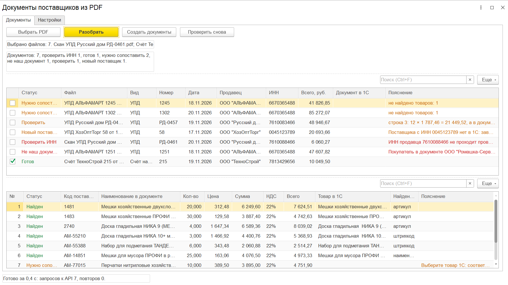
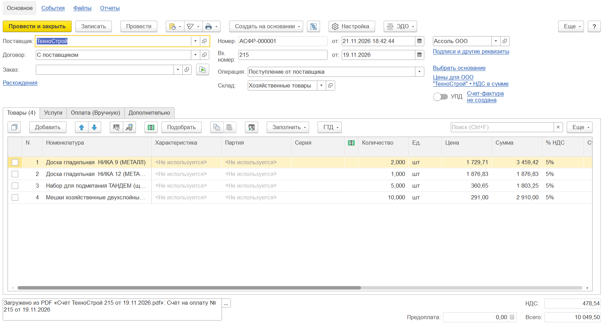
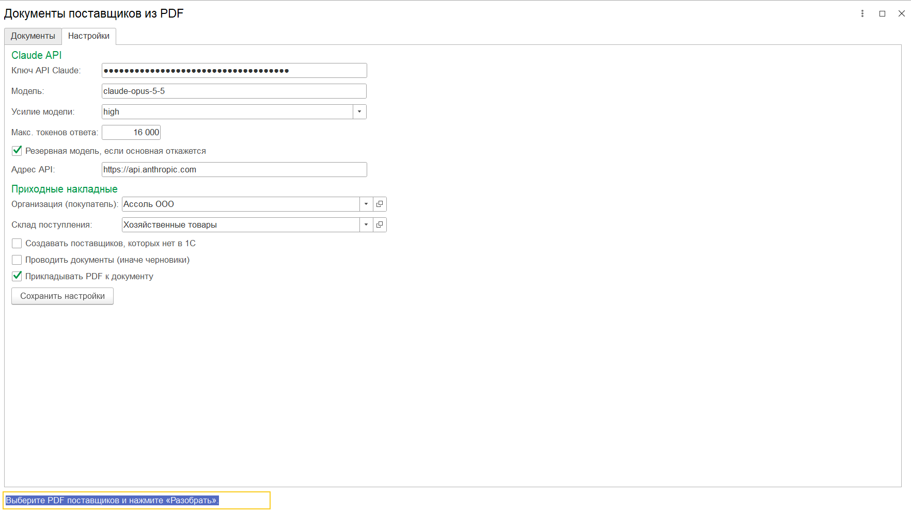

# Документы поставщиков из PDF в 1С:УНФ: разбор через Claude API с проверками 1С

Поставщики присылают УПД и счета в PDF, часто сканами. Менеджер перепечатывает их в приходные накладные: десятки строк, ИНН, суммы, ставки НДС. Ошибка в одной цифре всплывает потом в сверке с поставщиком или в книге покупок. Обработка отправляет PDF в Claude API, получает реквизиты и строки по JSON-схеме и создаёт черновик приходной накладной с приложенным PDF. На слово модели она не верит: контрольную сумму ИНН, покупателя, арифметику каждой строки и итогов, ставки НДС и дубли проверяет 1С, а документ с расхождением без подтверждения человека не создаётся.



Показано на демобазе «1С:Управление нашей фирмой 3.0»: поставщики «АЛЬФАМАРТ», «Русский дом», «ТехноСтрой» и товары склада «Хозяйственные товары» из этой базы. Образцы документов (УПД, счёт на оплату, скан) сгенерированы скриптом `samples/make_invoices.js`, у вымышленных компаний ИНН из несуществующего региона 00. Тесты идут на моке Claude API: ответы модели на образцы записаны в `samples/gen/claude_fixtures.json`, а запрос мок проверяет так, как его проверяет API. С живым ключом обработка отправляет тот же запрос.

## Что делает

1. Отправляет PDF в Claude API: УПД, счёт-фактуру, ТОРГ-12, счёт на оплату, в том числе скан без текстового слоя. Модель возвращает номер и дату, продавца и покупателя с ИНН и КПП, строки с кодами, количеством, ценами, суммами и ставками НДС, итоги и отдельным списком то, что прочитано неуверенно. Ответ ограничен JSON-схемой, поэтому он всегда разбирается.
2. Проверяет всё это в 1С: контрольную сумму ИНН по правилам ФНС, совпадение покупателя с организацией, количество на цену и налог в каждой строке, сумму строк против итога документа, наличие ставки НДС в справочнике, не загружен ли документ раньше.
3. Ищет товары: по запомненному соответствию поставщика, по штрихкоду, по артикулу, по наименованию. Если товара нет, его выбирают в строке один раз, и соответствие запоминается: в следующем документе этого поставщика товар найдётся сам.
4. Создаёт «Приходную накладную» черновиком или проведённой, как задано в настройках: поставщик, договор, склад, входящий номер и дата, строки с суммами поставщика. Итог накладной в 1С сверяется с итогом PDF, сам PDF прикладывается к накладной.
5. Поставщика, которого нет в 1С, создаёт по ИНН и КПП из документа, если это разрешено в настройках.

## Где такой разбор обычно ломается

| Что бывает в жизни | Что делает обработка |
|---|---|
| Модель прочитала цифру ИНН неверно: скан, печать поверх реквизитов | Контрольная сумма ИНН не сходится, документ не создаётся. В пояснении неверный ИНН и то, в чём модель сама не уверена |
| Документ пришёл не тому адресату | ИНН покупателя сверяется с организацией из настроек, статус «Не наш документ» |
| Поставщик ошибся в сумме строки | «12 × 1 787,46 = 21 449,52, а в документе 21 467,52»: документ ждёт подтверждения. Если подтвердить, накладная создаётся по суммам поставщика с пометкой в комментарии |
| В счёте цены с НДС, а в УПД без | Модель отмечает, как напечатаны цены. Накладная получает нужный флаг «Сумма включает НДС», итог сверяется с документом |
| Поставщик на УСН с НДС 5 % или 7 % | Ставки 22, 10, 7, 5, 0 % и «без НДС» берутся из справочника 1С, налог проверяется по каждой строке |
| Документ на двух страницах | Строки переносятся со всех страниц, число строк и итог сверяются |
| Тот же PDF загрузили второй раз | Пара «поставщик и входящий номер» уже есть: статус «Уже загружен», второй накладной нет. Перед записью проверка повторяется в транзакции |
| В документе товар, которого нет в 1С | Строка «Нужно сопоставить», документ без отметки. Товар выбирают один раз, дальше он находится по соответствию поставщика |
| У поставщика наименование в других кавычках и с лишними пробелами | Наименования сравниваются без учёта регистра, кавычек и пробелов |
| В 1С у контрагента не заполнен КПП, а в документе он есть | Поставщик находится по ИНН |
| API ответил 429 или 529, пропала связь | Пауза по заголовку retry-after или растущая: 2, 4, 8 секунд и дальше до минуты. После заданного числа попыток ошибка этого документа, остальные файлы разбираются |
| Модель отказалась отвечать | API сам повторяет запрос на резервной модели (`fallbacks`). Если отказала и она, у документа понятная ошибка |
| Ответ обрезан по лимиту токенов | Обрезанный ответ не принимается за полный: ошибка с подсказкой увеличить лимит или разделить PDF |
| Ключ API неверный или отозван | Разбор останавливается на первом ответе 401, остальные файлы не отправляются |
| `Base64Строка` в 1С переносит строку каждые 76 символов, а API принимает base64 одной строкой | Переносы убираются до отправки, тест сверяет, что раскодированный base64 совпадает с файлом |



## Как проверено

115 автоматических проверок на демобазе против мока Claude API, включая пакетный разбор папки, как из планировщика. Мок проверяет ключ и версию API, base64 без переносов, схему ответа (все объекты закрыты), бету резервной модели и запрет `temperature`. Сбои тесты включают служебными методами мока: 429 с retry-after, 529, 500, ответ 400 на один файл, отказ модели, обрезанный ответ, ответ резервной модели. Ожидаемые числа считает генератор образцов по данным документов, отдельно от кода обработки. Отрывок отчёта:

```
Проверок: 115, пройдено: 115, не пройдено: 0.

Разбор семи документов поставщиков
  ok    УПД 1245: поставщик найден по ИНН, хотя в 1С у него нет КПП
  ok    найдено по штрихкоду
  ok    найдено по наименованию: другие кавычки и пробелы
  ok    двухстраничный УПД: все 36 строк с обеих страниц
  ok    ошибка поставщика в строке 3: «Проверить»
        строка 3: 12 × 1 787,46 = 21 449,52, а в документе 21 467,52
  ok    скан: цифра ИНН прочитана неверно, контрольная сумма это ловит
  ok    покупатель другая организация
Товар выбран вручную, документы созданы
  ok    сумма документа равна итогу УПД
  ok    PDF приложен к накладной
  ok    соответствие для нового товара запомнено
Повторный разбор: дубли и запомненное соответствие
  ok    УПД 1245 второй раз: уже загружен
  ok    новый товар во втором УПД нашёлся по запомненному соответствию
Сбои API: 429, 529, 500, отказ модели, обрыв ответа
  ok    повтор не раньше, чем просил API в retry-after
  ok    паузы растут: 2 с, потом 4 с
  ok    max_tokens: ошибка документа со словом «обрезан»
  ok    основная модель отказалась, ответила резервная: документ разобран
Ключ API
  ok    после 401 остальные файлы не отправляются
Пакетный запуск: обработка с параметром РазобратьПапку, как из планировщика
  ok    новый УПД создан, скан с неверным ИНН остался в отчёте
```

Полный отчёт с каждой проверкой: [tests/report.txt](tests/report.txt).

## Как подключить

1. Получить ключ Claude API в консоли Anthropic (раздел API keys).
2. Открыть `build/РазборДокументовПоставщиков.epf` через «Файл → Открыть» или добавить в справочник «Дополнительные отчеты и обработки» (в модуле есть `СведенияОВнешнейОбработке()`).
3. На странице «Настройки» указать ключ, организацию и склад и нажать «Сохранить настройки». Модель по умолчанию Claude Opus 5.5 с усилием high, их можно сменить там же.
4. «Выбрать PDF», «Разобрать», проверить строки и выбрать товар там, где «Нужно сопоставить», затем «Создать документы».



Для запуска по расписанию, например по папке, куда сохраняются вложения из почты:

```
1cv8.exe ENTERPRISE /F <база> /N <пользователь> /Execute РазборДокументовПоставщиков.epf /C "РазобратьПапку;C:\Обмен\PDF;C:\Обмен\отчет.txt"
```

Документы со статусом «Готов» создаются сами, остальные попадают в отчёт с причиной:

```
Документы поставщиков из PDF, 21.11.2026 18:40:32
Документов: 2, проверить ИНН 1, создан 1.
  Скан УПД Русский дом РД-0461.pdf  Проверить ИНН  ИНН продавца 7610088466 не проходит проверку контрольной суммы: вероятно, цифра прочитана неверно; модель не уверена: ИНН продавца: седьмая цифра в скане читается неуверенно
Создано документов: 1, пропущено: 0, ошибок: 0.
```

## Устройство

* Запрос к Claude API собирается без SDK, которого у 1С нет: `POST /v1/messages`, версия API 2026-10-21, PDF документом в base64, `output_config.format` с JSON-схемой и усилием, `fallbacks: "default"` с бетой `server-side-fallback-2026-07-01`. Ответ проверяется на `stop_reason` до чтения: отказ и обрезанный ответ обрабатываются отдельно.
* Разбор идёт шагами, как в обмене с WB: `ВызватьПаузу` в вызове с клиента запрещена, поэтому шаг возвращает, сколько ждать, а форма ждёт через обработчик ожидания.
* Проверки и поиск товаров пакетные: один запрос на поставщиков, один на дубли, по одному на каждый способ поиска товаров.
* БСП: ключ API в безопасном хранилище, PDF в присоединённых файлах накладной, прокси из настроек получения файлов из интернета, регистрация как дополнительной обработки, журнал регистрации.
* `tests/` обработка с автотестами. `tools\test.ps1 -Base <база> -Reference <копия 1Cv8.1CD> -Build` поднимает мок, восстанавливает демобазу из эталона, собирает обработки, запускает тесты, проверяет пакетный запуск и снова восстанавливает базу.
* `tools/claude-mock.js` мок Messages API на Node.js без зависимостей.
* `samples/make_invoices.js` печатает образцы из HTML в PDF через Microsoft Edge. Скан делается картинкой без текстового слоя, как настоящий.

Проверено на «Управление нашей фирмой (учебная)» 3.0.13.251, платформа 8.5.1, файловый режим. С живым ключом Claude API обработка не запускалась. Формат запроса и ответов сверен с документацией Claude API на ноябрь 2026 года.

Другие работы: [загрузка прайса поставщика](https://github.com/matbcontrol/1c-supplier-price-import), [обмен с Wildberries](https://github.com/matbcontrol/1c-wb-exchange), [лист сборки заказов WB](https://github.com/matbcontrol/1c-wb-picking-list), [прибыль товаров на WB](https://github.com/matbcontrol/1c-wb-profit-report).

## Нужна похожая обработка?

Сделаю разбор входящих документов под вашу конфигурацию (УНФ, УТ 11, КА, Бухгалтерия): УПД и счета из почты, акты, ТОРГ-12. Если документы нельзя отправлять в зарубежный сервис, сделаю тот же разбор на YandexGPT или GigaChat. Telegram: @MATb_CONTROL
